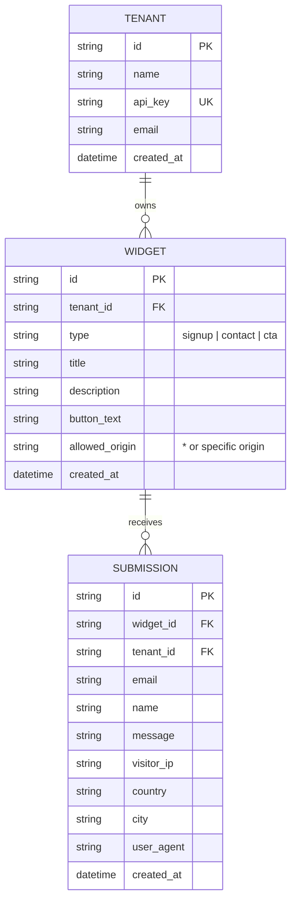

# Design Document: Embeddable Widget & Lead-Capture Platform

**Author**: Deepak Prajapati  
**Track**: FlyRank Backend Engineering Capstone  
**Status**: Committed / Active  

---

## 1. Problem Statement
Every customer-facing website needs lead capture (contact forms, newsletter signups, feedback prompts). However, building custom forms on every site introduces maintenance overhead, insecure public endpoints, lack of spam prevention, and missing visitor analytics.

**The Solution**: A multi-tenant platform where customers configure forms once, receive a single ``
2. **Dynamic Config Retrieval**:
   `GET http://localhost:8000/widgets/w_123/config`  
   *Headers*: `Cache-Control: public, max-age=60` (short-lived config cache).
3. **Client-Side Shadow DOM / Container Render**:
   `widget.js` dynamically creates an isolated container, inserts form fields, and injects a hidden honeypot input field (`hp_company_field`).
4. **Public Submission Path**:
   `POST http://localhost:8000/submissions`  
   Sends payload cross-origin with CORS headers.

---

## 4. API Surface Contracts

### Path A: Widget Owner Management (Authenticated)
- `POST /api/v1/widgets`: Create widget. Returns widget object & embed snippet.
- `GET /api/v1/widgets`: List authenticated tenant's widgets.
- `GET /api/v1/widgets/{id}`: Retrieve widget details.
- `DELETE /api/v1/widgets/{id}`: Delete widget.
- `GET /api/v1/dashboard/stats`: Submissions count, widget breakdowns, and geographic distribution.

### Path B: Public Widget Delivery (Public, Cached, CORS)
- `GET /static/widget.js`: Serves versioned widget script (`Cache-Control: public, max-age=86400, immutable`).
- `GET /widgets/{id}/config`: Returns JSON widget config (`Cache-Control: public, max-age=60`).

### Path C: Public Submission Ingestion (Public, CORS, Hardened)
- `OPTIONS /submissions`: CORS preflight responding with allowed origins, headers, and methods.
- `POST /submissions`:
  - Input: `widget_id`, `email`, `name`, `message`, `hp_company_field` (honeypot).
  - Validation: Pydantic schema enforcing email format, payload size < 100KB.
  - Rate Limiter: Max 10 requests/minute per IP, burst 5.
  - Spam Guard: Non-empty `hp_company_field` -> HTTP 400 rejection (or silent discard).
  - Geo Fallback: `ip-api.com` -> `ipapi.co` -> fallback to `None`.
  - Side Effect: Asynchronous confirmation email log (isolated failure).
  - Return: `HTTP 201 Created` with submission ID.

---

## 5. Explicit Non-Goals
- **Non-Goal**: We are NOT building a complex drag-and-drop form designer or visual canvas builder. The widget supports standard core templates (`signup`, `contact`, `cta`).
- **Non-Goal**: We are NOT setting up paid cloud CDNs or external domain registrations. The external customer website is simulated locally on a distinct origin (`http://localhost:5500` vs `http://localhost:8000`).

